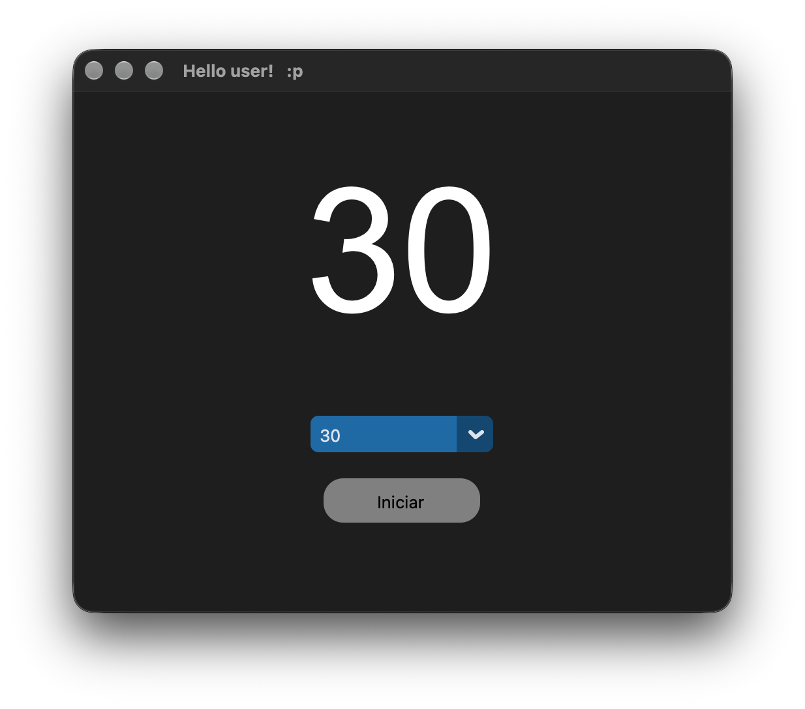

<h1 align="center">Thimer!</h1>

  Timer Pomodoro, simples e fácil de usar!

  

<h2>Sobre o projeto</h2>

  O projeto foi desenvolvido inteiramente por mim, utilizando Python, Tkinter e CustomTkinter.

  Ele surgiu depois que abri a App Store e percebi que um simples timer custava R$ 5. Foi então que decidi desenvolver minha própria versão.

  <strong>Desenvolvido por:</strong> thiagoeduardoolimpio(Github)

  <strong>Status:</strong> Em desenvolvimento.

